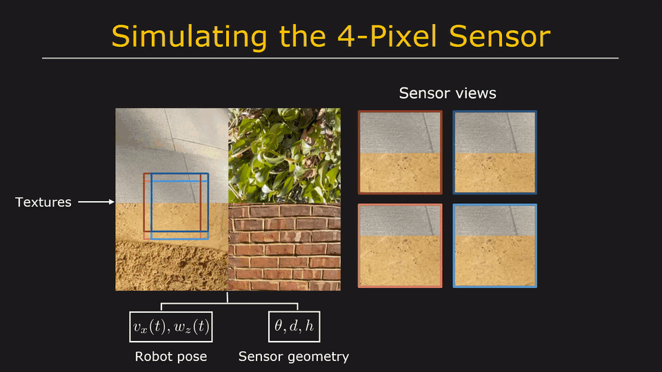
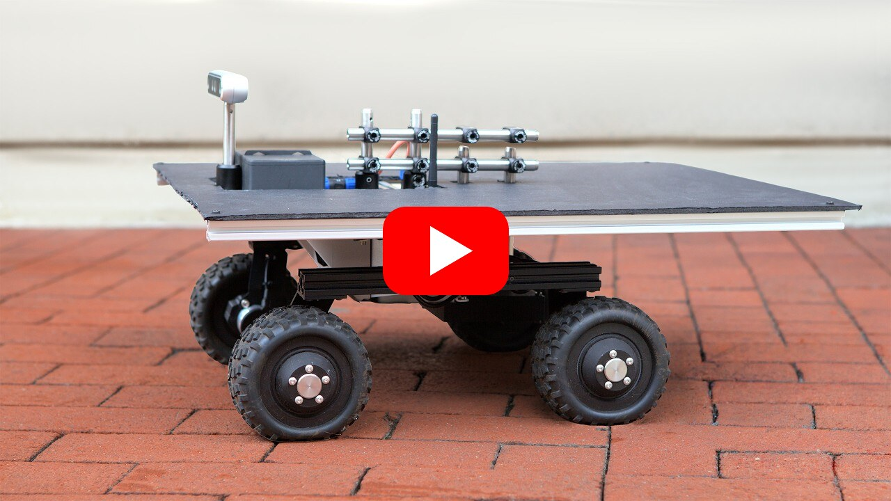
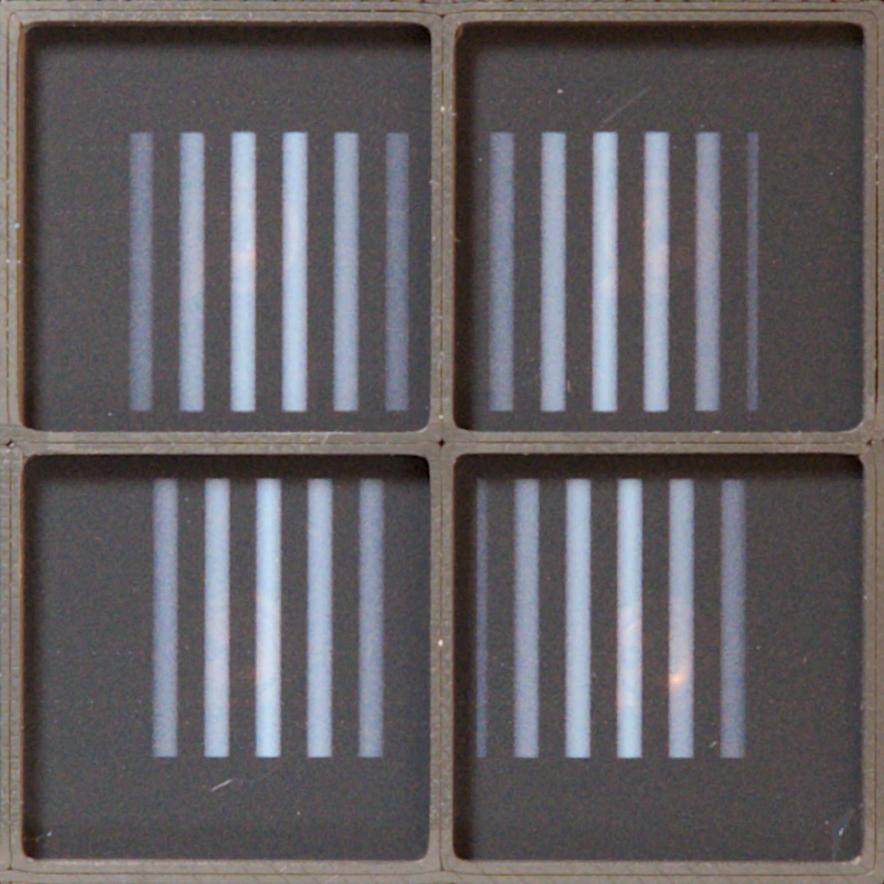
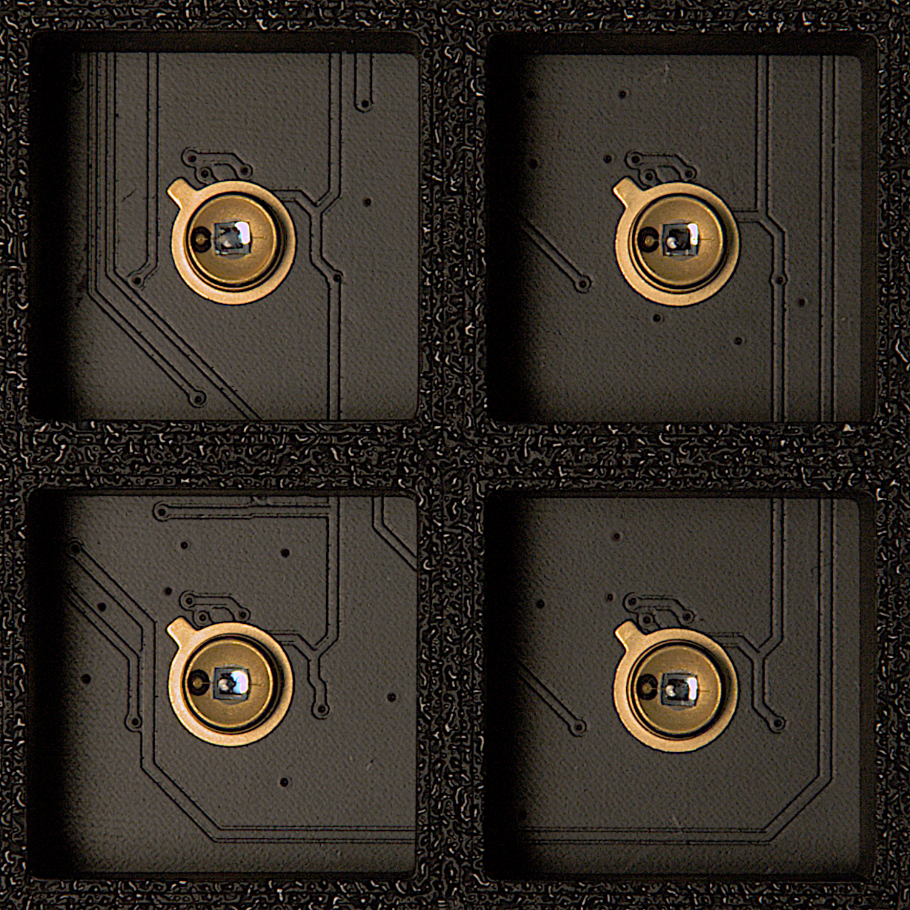

<div align="center">

# Minimalist Visual Inertial Odometry

**Odometry with just 4 pixels and an IMU**

Francesco Pasti<sup>1,2</sup> · Jeremy Klotz<sup>2</sup> · Nicola Bellotto<sup>1</sup> · Shree K. Nayar<sup>2</sup>

IEEE Robotics and Automation Letters (RA-L), 2026

<sup>1</sup>University of Padua, IT &emsp; <sup>2</sup>Columbia University, USA

[**Paper**](https://ieeexplore.ieee.org/document/11731445) • [**Narrated Video**](#narrated-video) • [**Installation**](#installation) • [**Quick Start**](#quick-start) • [**Citation**](#citation)

</div>

We built a sensor consisting of 4 masked photodiodes, where each photodiode produces a single scalar value. We model the mask transmittance as Gabor functions, i.e., a sinusoid modulated by a Gaussian envelope. As the sensor moves across arbitrary textures, the measurements from the masked photodiodes robustly encode the linear velocity of the robot.

Pairing these measurements with the angular velocity from an IMU gives the full planar odometry of the robot. Although the sensor masks and the speed decoder are trained entirely in simulation, the system closely tracks reference VIO trajectories across diverse indoor and outdoor terrains without any real-world fine-tuning.

Our minimalist odometry system achieves **0.60%** drift over **920 m** of real-world driving with **1024× fewer pixels** than optical flow at comparable accuracy.


For more details, refer to the [paper](https://ieeexplore.ieee.org/document/11731445).

## Sensor Simulation Overview

<p align="center"></p>

The simulator generates the four photodiode views during motion.

Then, the effects of the finite area (b), the directional response (D), and the foreshortening effect (Ω) of the photodiodes are applied to each view. The result is then integrated (Σ) before simulating the electronic response of each photodiode by applying gain (G), read and quantization noise, and saturation.

Finally, two signals, $s_{cos}(t)$ and $s_{sin}(t)$, are computed and fed into a Temporal Convolutional Network (TCN). The TCN takes a temporal window of the input signals to predict the linear velocity $\hat{v}_x(t)$ of the sensor.

Since the simulator is **fully differentiable**, the loss is backpropagated to optimize not just the TCN but also the Gabor mask parameters ($\xi_0, \sigma, \alpha$).

## Narrated Video
<div align="center">
<a href="https://www.youtube.com/watch?v=6lgsv5Yid4w">
  
</a>
<p><em>The narrated video walks through the project. It covers the theoretical intuition behind the sensor, the design of the physically grounded simulator, and the experimental evaluation across diverse indoor and outdoor terrains.</em></p>
</div>

## Installation

### Python Environment
```bash
# 1. Clone the repository
git clone https://github.com/pastifra/four-pixel-vio.git
cd four-pixel-vio

# 2. Create the environment
conda env create -f environment.yml

# 3. Activate the environment
conda activate four-pixel-vio
```

### Data
To generate data, the simulator uses robot trajectories from TartanGround and high-resolution texture images from Matador.

Download the Matador images and TartanGround trajectories (~91 GB):
```bash
wget http://cave.cs.columbia.edu/old/projects/minvio/data/fourpx_sim_data.tar.gz
```

To download a larger set of trajectories, refer to [TartanAir/TartanGround](https://tartanair.org/tartanground.html).

For more information on the Matador images, refer to the [Matador website](https://cave.cs.columbia.edu/repository/Matador).

## Quick Start

### Simulator Tutorial
To understand the pipeline, we recommend going through the Jupyter notebook. It covers everything from instantiating the simulated sensors to an example of the final integrated trajectory.

```bash
jupyter notebook tutorial.ipynb
```

### Training

You can train the TCN decoder for the sensor and simulator model defined in `data/configs/demo_cfg.yml`. To customize the simulator, create your own version of this file; its comments explain every simulator parameter.

```bash
# 1. Activate the environment
conda activate four-pixel-vio

# 2. Train
python train.py --configs data/configs/demo_cfg.yml

# 3. Monitor progress during training
tensorboard --logdir data/logs
```

### Masks

You can visualize a high-resolution version of the trained masks, ready to be printed on transparency film.

To visualize the masks of a model other than the demo model, change the paths in `masks-printing/mask_model.yml`.

```bash
cd masks-printing

python mask_printing.py -d 1200 -t model --mask_fov 70 --model_list_file mask_model.yml -o mask.png
```

<div align="center">

&emsp;&emsp;

<p><em>(a) Example of trained masks printed on transparency film. (b) Hamamatsu S9119-01 photodiodes, whose physical parameters (solid angle, directivity, inter-detector distance, FOV, etc.) are used in the simulator.</em></p>

</div>

## Repository Structure
```bash
four-pixel-vio/
├── data/                  # Training configurations, pre-trained TCN model, and hardware transfer functions
├── masks-printing/        # Visualization tools for the 4-pixel masks
├── simulator/             # Core simulator physics and rendering engine
│   ├── cam_models.py      # 4-pixel sensor simulator and TCN decoder
│   └── views_simulator.py # 4-pixel views simulator
├── utils/
├── environment.yml
├── train.py               # Main training loop for the TCN velocity decoder
└── tutorial.ipynb         # Interactive tutorial of the simulator
```

## Citation
```bibtex
@ARTICLE{pasti2026minimalistodometry,
  author={Pasti, Francesco and Klotz, Jeremy and Bellotto, Nicola and Nayar, Shree K.},
  journal={IEEE Robotics and Automation Letters},
  title={Minimalist Visual Inertial Odometry},
  year={2026},
  volume={11},
  number={11},
  pages={13661-13668},
  doi={10.1109/LRA.2026.3742266}
}
```
